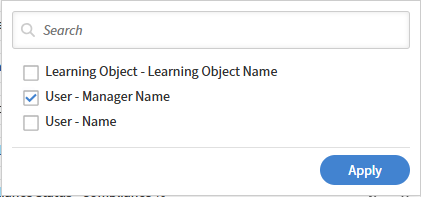

# Report Builder에서 사용자 지정 보고서 만들기

## 개요

필요한 열과 출력을 명확하게 볼 수 있고 사용 사례와 일치하는 기존 템플릿이 없는 경우 처음부터 만드는 것이 가장 좋습니다. 템플릿을 처음 사용하는 경우에는 Report Builder으로 시작하는 것이 좋습니다.

## 사용자 정의 보고서 작성

이 예에서는 각 관리자 아래에 준수 강의의 위험에 처한 학습자를 식별합니다.

1. 관리자 권한으로 Adobe Learning Manager에 로그인합니다.
2. **보고서**&#x200B;를 선택한 다음 **Report Builder**&#x200B;를 선택합니다.
3. **보고서** 탭을 선택한 다음 **보고서 만들기**&#x200B;를 선택합니다.
4. 보고서 이름을 입력합니다. 이름을 입력해야 합니다. 설명을 입력합니다(선택적).

   

5. 열 패널에서 다음 데이터 세트를 선택하고 확장합니다.

   * 사용자
   * 학습 목표
   * 사용자 준수 상태

6. 포함할 다음 열 옆의 **+**&#x200B;을(를) 선택합니다. 보고서 캔버스에 선택한 열이 표시됩니다.

   * 사용자- 이름
   * 사용자- 관리자 이름
   * 학습 객체- 학습 객체 이름
   * 사용자 준수 상태- 완료 %
   * 사용자 준수 상태- 준수 %

   

7. 캔버스에서 열을 드래그하여 열 순서를 변경합니다.
8. 열의 이름을 바꾸려면 열의 **별칭** 필드에 이름을 입력합니다. 별칭을 지정하면 별칭이 열 머리글로 사용됩니다. 별칭을 지정하지 않으면 기본 열 머리글에 데이터 집합 이름이 포함됩니다. 예를 들어, 학습 객체 데이터 세트의 이름은 학습 객체 - 이름으로 나타납니다.

   **열 머리글**

   Report Builder은 데이터 집합 간에 이름이 비슷한 열을 구별할 수 있도록 기본 열 머리글에 데이터 집합 이름을 포함합니다. 예를 들어 학습 객체 데이터 세트에서 [이름]을 선택하면 열 머리글이 학습 객체 - 이름으로 나타납니다.

   열에 대해 사용자 정의 별칭을 지정하는 경우 Report Builder은 기본 열 머리글 대신 별칭을 사용합니다.

   **기존 보고서에 미치는 영향**

   업그레이드 후 사용자 정의 별칭 없이 기본 열 이름을 사용하는 기존 보고서에는 업데이트된 열 머리글이 표시됩니다. 예를 들어 학습 객체 데이터 세트의 이름이 이름에서 학습 객체 - 이름으로 변경됩니다.

   보고서 데이터, 필터 및 일정은 영향을 받지 않습니다.

   보고서 출력을 머리글별로 열을 참조하는 스크립트, 스프레드시트, BI 대시보드 또는 통합에서 사용하는 경우 다운스트림 시스템을 확인하고 필요에 따라 이전 열 머리글에 대한 참조를 업데이트합니다.

   특정 열 머리글을 유지하려면 열에 대한 사용자 정의 별칭을 설정합니다.

9. **보고서 저장**&#x200B;을 선택합니다.

## 보고서 다운로드

1. 오른쪽 상단에서 **작업**&#x200B;을 선택합니다.

   

2. **다운로드**&#x200B;를 선택합니다. 보고서가 준비되면 알림 아이콘에서 다운로드할 수 있습니다.

다운로드된 보고서(csv)에는 다음 열이 포함되어 있습니다.

* name
* managerName
* name
* completionPct
* compliancePct

## 그룹화 기준, 필터 및 정렬 적용

### 필터

이제 보고서를 다운로드했으므로 completionPct 또는 compliancePct 가 100인 필터를 적용하십시오.

1. 보고서를 열고 오른쪽 상단에서 **편집**&#x200B;을 선택합니다.
2. **필터 추가**&#x200B;를 선택하고 필터를 적용할 열을 검색합니다.

   

3. **추가**&#x200B;를 선택합니다.
4. 필터를 AND/OR 논리와 결합합니다. 필터 행 간에 전환하는 연산자를 선택합니다.

   

5. **보고서 저장**&#x200B;을 선택하고 보고서를 다운로드합니다.

다운로드한 보고서에는 completionPct 또는 compliancePct가 100인 레코드가 포함되어 있습니다.

### 그룹화 기준

관리자별로 레코드를 그룹화하여 다음 작업을 수행합니다.

* 관리자별 학습자 데이터 수집
* 관리자 수준 평균 계산
* 각 관리자 아래에 학습자 수

1. 보고서를 열고 오른쪽 상단에서 **편집**&#x200B;을 선택합니다.
2. **그룹화 기준:Select**&#x200B;을 선택하고 **사용자 관리자 이름** 열을 선택합니다.

   

3. 다음 열을 집계합니다.

   * 사용자 이름
   * 학습 개체 - 학습 개체 이름

4. **Count**&#x200B;을(를) 열의 집계 함수로 선택합니다.

   

   집계된 열에 대한 **열 머리글:**

   합산 함수를 적용할 경우 기본 열 머리글에는 합산 함수가 포함됩니다. 예를 들어 **Count**&#x200B;을(를) **학습 개체 - ID**&#x200B;에 적용하면 열 머리글은 **학습 개체 - ID**&#x200B;의 **Count**(으)로 나타납니다. 사용자 정의 별칭을 지정한 경우 별칭은 변경되지 않은 상태로 유지됩니다.

5. 학습 객체에 대해 반복 - 학습 객체 이름.

   

6. **보고서 저장**&#x200B;을 선택하고 보고서를 다운로드합니다.

다운로드한 보고서에는 학습자 교육 성과에 대한 관리자 측 요약이 포함되어 있습니다. 각 관리자의 평균 완료율, 평균 준수율 및 총 학습자 수가 표시됩니다. 데이터는 모든 그룹에 걸쳐 보편적인 교육 완료를 나타내는 반면 규정 준수 성과는 관리자 간에 상당한 차이를 보인다.

### 정렬

보고서를 각 관리자의 학습자 수를 기준으로 내림차순으로 정렬합니다.

1. 보고서를 열고 오른쪽 상단에서 **편집**&#x200B;을 선택합니다.
2. **정렬 추가**&#x200B;를 선택합니다.
3. 사용자 이름을 검색한 다음 **사용자 이름**&#x200B;을 선택합니다.
4. **내림차순**&#x200B;을 선택합니다.

   

5. **추가**&#x200B;를 선택합니다.
6. **보고서 저장**&#x200B;을 선택하고 보고서를 다운로드합니다.

다운로드된 보고서에는 관리자당 학습자 수가 내림차순으로 나열됩니다.
