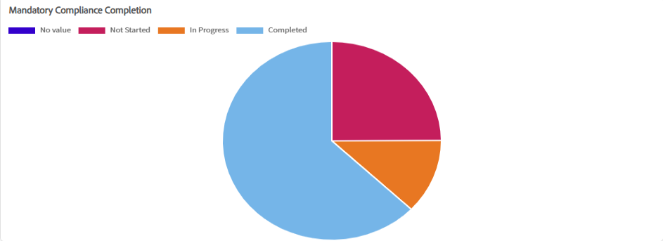
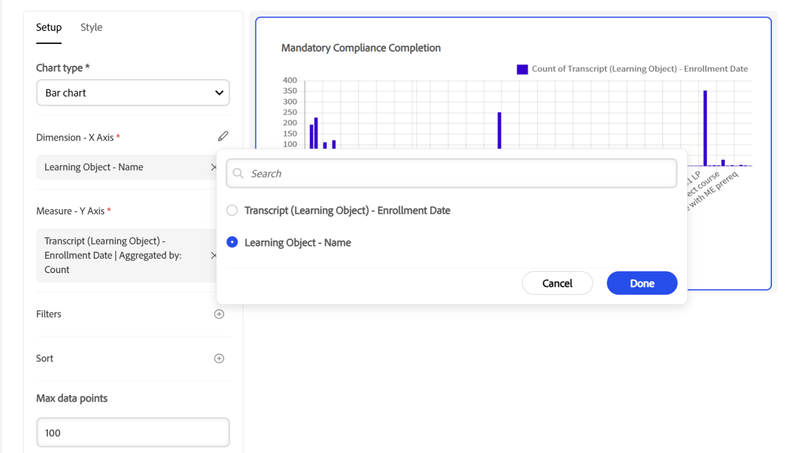

# Report Builder의 시각화

Adobe Learning Manager Report Builder의 시각화를 통해 저장된 보고서가 차트 및 대시보드로 변환됩니다. 스프레드시트 도구에서 데이터를 변형하지 않고도 그룹을 비교하고, 추세를 표시하고, 결과를 공유할 수 있습니다.

>[!IMPORTANT]
>
>Report Builder의 시각화(차트 및 대시보드)는 Adobe Learning Manager Ultimate 고객만 사용할 수 있습니다. Prime 버전에서는 사용할 수 없습니다.

## Report Builder 시각화 정보 {#about-visualizations}

시각화는 Report Builder에 저장한 보고서를 기반으로 작성되는 차트 또는 차트 대시보드입니다. 플롯할 보고서 열을 선택하면 Report Builder은 보고서 데이터에서 차트를 그립니다. 열을 직접 플롯하거나 보고서에서 요약 데이터를 플롯할 수 있습니다.

* **보고서에 대한 차트 만들기:** 보고서를 열고 **시각화**&#x200B;를 선택한 다음 차트를 만듭니다. [보고서에서 차트 만들기](#create-chart-from-report)를 참조하세요.
* **대시보드의 차트 그룹화:** 보고서를 데이터 원본으로 선택한 다음 차트를 추가합니다. [대시보드 작성](#build-dashboard)을 참조하세요.
* **공유 및 보기:** 대시보드를 읽기 전용 모드로 보고 필터링하는 관리자와 공유합니다.

차트는 다음 두 가지 모드로 작동합니다.

* **구성 모드:** 차트를 만들거나 편집합니다.
* **보기 모드:** 차트가 빌드되는 방식을 변경하지 않고 차트가 표시되는 내용을 필터링합니다.

## 차트 종류 및 사용 시기 {#chart-types}

대답할 질문별로 차트 유형을 선택합니다.

| 차트 유형 | 다음을 위해 사용: | 예 |
|---|---|---|
| 선 | 시간이 지남에 따라 값이 어떻게 변하는지 보여 줍니다. | 생성 개월별 등록 |
| 막대 또는 막대 | 범주 간 값을 비교합니다. 그룹, 스택 및 100% 스택 레이아웃을 사용할 수 있습니다. | 등록 상태별 학습자 |
| 파이 | 각 범주의 전체 점유율을 표시합니다. 1% 미만의 세그먼트는 **기타** 세그먼트로 그룹화됩니다. | 카탈로그별 등록 |
| 큰 수 | 하나의 키 메트릭을 강조 표시합니다. | 이번 분기 총 완료 |
| 표 | 정확한 값을 표시합니다. 열의 하위 집합을 선택하고 열 대신 하나의 날짜 열을 행으로 표시할 수 있습니다(열-행 보기). | 사용자당, 월별 학습 소요 시간 |

>[!NOTE]
>
>월별 등록과 같은 추세 보고서에서 작성된 라인 차트에는 날짜별로 그룹화된 데이터의 현재 스냅샷이 표시됩니다. 그들은 데이터가 각각의 과거 날짜를 어떻게 보는지 보여주지 않는다. 자세한 내용은 Report Builder 개념 및 용어 를 참조하십시오.

## 시각화 용어 {#visualization-terms}

| 용어 | 의미 |
|---|---|
| 보고 | 열, 필터 및 그룹화의 저장된 Report Builder 구성. 차트는 보고서에서 작성됩니다. |
| 차트 수준 필터 | 차트를 만들거나 편집할 때 설정하는 필터입니다. 차트가 그리는 데이터를 제한합니다. |
| 페이지 수준 필터 | 뷰어가 페이지 또는 대시보드의 모든 차트에 적용되는 필터입니다. 보고서 자체의 필터를 좁힐 수는 있지만 넓힐 수는 없습니다. |
| Report Builder 대시보드 | Report Builder에서 작성하는 차트의 페이지입니다. |

## 보고서에서 차트 만들기 {#create-chart-from-report}

저장된 보고서에서 차트를 만들어 등록, 완료 또는 사용한 시간 데이터를 한 눈에 볼 수 있습니다. 차트를 한 번 구성하고 열 때마다 보고서 데이터에서 차트를 그립니다.

### 차트를 만들기 전에 {#before-you-create-chart}

다음을 확인합니다.

* **보고서를 저장합니다.** 차트를 추가하는 옵션은 보고서를 저장한 후 Report Builder 페이지에 나타납니다.
* **내 보고서를 사용하세요.** 공유 보고서를 복제하여 복사본을 만든 다음 이를 사용하여 차트를 만듭니다.
* **크기를 확인하십시오.** 행이 1,000만 개가 넘는 보고서는 플로할 수 없습니다. 데이터 포인트가 10,000개가 넘는 요약 보고서는 표시되지 않습니다. 차트 및 대시보드 제한을 참조하십시오.
* **시각화를 위해 데이터를 최적화합니다.** 적절한 보고서 수준 또는 차트 수준 필터를 적용하여 표시되는 데이터 양을 제한합니다. 차트를 로드하는 데 필요한 시간은 보고서 데이터의 볼륨, 선택한 날짜 범위, 보고서에 사용된 데이터 집합과 테이블의 조합 등의 요소에 따라 달라집니다. 대용량 데이터 볼륨 또는 복잡한 데이터 집합 조합을 처리하는 보고서는 로드 시간이 오래 걸리거나 시간 초과될 수 있습니다. 이러한 경우 필터 또는 날짜 범위를 좁히고 다시 시도하십시오.
* **열을 알아보세요.** 차트의 X축(차원) 및 Y축(측정 단위)은 보고서의 열에서 가져옵니다. 보고서 자체를 요약하려면 **그룹화 기준** 및 집계를 사용하십시오. 자세한 내용은 그룹별 적용 및 집계를 참조하십시오.

### 차트 구성 {#configure-chart}

1. 관리자로 Adobe Learning Manager에 로그인합니다.
1. **보고서**&#x200B;를 선택한 다음 **Report Builder**&#x200B;를 선택합니다.
1. **보고서** 탭을 선택한 다음 저장된 보고서를 엽니다. 예를 들어 각 날짜에 학습 플랫폼에 로그인한 사용자 수를 보여 주는 사용자 로그인 추세 보고서를 선택합니다.
1. 왼쪽 탐색에서 **시각화**&#x200B;를 선택합니다. **설정** 및 **스타일** 탭이 있는 패널이 열립니다.

   

   >[!NOTE]
   >
   >차트가 있으면 **편집**&#x200B;을 선택한 다음 **+**&#x200B;을 선택하여 다른 차트를 추가합니다.

1. **차트 종류**&#x200B;에서 **꺾은선형 차트**&#x200B;와 같은 형식을 선택합니다. 이 필드는 필수입니다.
1. **Dimension - X축** 옆에 있는 추가 아이콘을 선택한 다음 보고서 열을 선택합니다. 날짜 열의 경우 날짜 또는 월과 같은 **날짜 세분성**&#x200B;도 선택합니다.

   {width="650"}

1. 날짜 차원을 추가하려면 **추가**&#x200B;를 선택합니다.
1. **측정값 - Y축** 옆에 있는 추가 아이콘을 선택한 다음 보고서 열 및 집계 방법(예: **개수**)을 선택합니다.

   {width="650"}

1. **추가**&#x200B;를 선택하여 측정값을 추가합니다.
1. (선택 사항) **필터 추가**&#x200B;를 선택하여 플로팅된 데이터를 최근 30일과 같은 범위로 제한합니다. **추가**&#x200B;를 선택합니다.

   {width="650"}

1. (선택 사항) **정렬** 열을 추가한 다음 **오름차순** 또는 **내림차순**&#x200B;을 선택합니다. **추가**&#x200B;를 선택합니다.

   {width="650"}

1. (선택 사항) 라인 차트의 경우 누락된 데이터에 대해 **간격 처리**&#x200B;를 설정합니다. [누락된 데이터에 대한 간격 처리](#gap-handling)를 참조하세요.
1. **최대 데이터 요소**&#x200B;에 차트에 표시할 데이터 요소 수를 입력합니다. 기본값은 100포인트이며 제한은 10,000입니다.
1. **나머지 포인트를 &#39;기타&#39;**(으)로 그룹화합니다. Report Builder은 최대 **최대 데이터 포인트** 값까지의 개별 데이터 포인트를 표시하고 이 제한을 초과하는 모든 데이터를 **기타**&#x200B;라는 하나의 추가 범주로 결합합니다.

   예를 들어 **최대 데이터 요소**&#x200B;가 150이고 쿼리에서 200포인트를 반환하는 경우:

   * Report Builder은 150점을 개별적으로 표시합니다.
   * Report Builder은 나머지 50점을 **기타**&#x200B;로 결합합니다.
   * 차트에는 151개의 점이 그려져 있습니다. 150개 + **기타**.

1. **다음**&#x200B;을 선택합니다. 이제 차트를 사용자 정의할 수 있습니다.

   {width="650"}

#### 누락된 데이터에 대한 간격 처리 {#gap-handling}

간격 처리는 계열에 있는 하나 이상의 관측값에 NULL, NA, NaN 또는 빈 셀과 같은 숫자 값이 없을 때 차트가 수행하는 작업을 정의합니다.

데이터가 다음과 같다고 가정합니다.

| X | 값 |
|---|---|
| 1월 | 10 |
| 2월 | 15 |
| 3월 | N/A |
| 4월 | N/A |
| 5월 | 25 |

다음 표에서는 세 가지 동작을 보여 줍니다.

| 간격 처리 | 개념적 결과 | 어떻게 구성됩니까? |
|---|---|---|
| 0까지 선 표시 | `10 -> 15 -> 0 -> 0 -> 25` | 누락된 값을 0으로 처리합니다. |
| 건너뛰기 | `10 -> 15   25` | 누락된 점을 플롯하지 않고 선을 분할합니다. |
| 연결 | `10 -> 15 ----> 25` | 누락된 점을 플롯하지 않고 양쪽의 유효한 관측값을 연결합니다. |

>[!NOTE]
>
>Connect가 보간이 아닙니다. 3월과 4월이 누락된 경우 2월을 직접 5월에 연결하면 알려진 두 값 사이에 시각적 선이 그려질 뿐입니다. 실제 3월과 4월의 값은 생성되지 않습니다.

### 차트 사용자 지정 {#customize-chart}

차트를 명확하고 읽기 쉽도록 사용자 정의합니다. **스타일** 탭에서 제목을 추가하고, 축 제목과 범례를 표시하거나 숨기고, 범례를 배치 및 정렬하고, 각 계열의 색상을 설정할 수 있습니다. 스타일 변경은 차트 표시 방식에만 영향을 줍니다. 그들은 그것이 계획하는 데이터를 바꾸지 않는다.

1. 차트 위에 제목을 표시하려면 **차트 제목 표시**&#x200B;를 선택합니다. 숨기려면 옵션을 끕니다.
1. **차트 제목**&#x200B;에서 차트의 제목을 입력합니다.
1. 축에 레이블을 지정하려면 **X축에 제목 표시** 및 **Y축에 제목 표시**&#x200B;를 선택합니다.
1. 각 줄을 식별하는 키를 표시하려면 **범례 표시**&#x200B;를 선택합니다.
1. **범례 위치**&#x200B;에서 왼쪽, 가운데 또는 오른쪽 아이콘을 선택하여 범례를 정렬합니다.
1. **선 색상**&#x200B;에서 계열 옆의 색상 견본을 선택합니다(예: **사용자 수**).
1. 색상 피커의 팔레트에서 색상을 선택하거나 사용자 정의 탭을 사용하여 원하는 색상을 정의합니다.
1. 색상을 변경할 각 선에 대해 앞의 두 단계를 반복합니다.
1. **만들기**&#x200B;를 선택하여 차트를 추가합니다. 기존 차트를 편집하려면 **저장**&#x200B;을 선택하십시오.

   {width="650"}

차트는 제목, 범례 및 선 색상과 함께 나타납니다.

>[!TIP]
>
>* 서로 및 배경과 선명한 대비를 이루는 색상을 선택합니다. 선과 선을 구분하는 유일한 방법이 아닌 색상을 구분하기 위해 제목과 범례를 유지합니다.
>* **범례 위치**, **범례 맞춤** 및 **선 색상** 옵션은 **범례 표시**&#x200B;가 켜져 있는 경우에만 적용됩니다.
>* 차트의 각 줄에는 **설정** 탭에서 추가한 측정 단위당 하나의 고유한 견본이 있습니다.

한 페이지에 차트를 정렬하려면 [대시보드 작성](#build-dashboard)을 참조하세요.

## 원형 차트 만들기 {#create-pie-chart}

파이 차트를 사용하여 필수 교육을 완료한 직원의 점유율이나 강의 형식의 혼합과 같이 전체 과정이 어떻게 나누어지는지 보여 줍니다. 각 분할 영역은 총계에 대한 한 범주의 몫을 보여준다.

### 파이 차트 정보 {#about-pie-charts}

원형 차트는 범주당 하나의 분할 영역을 그립니다. 분할 영역 크기는 전체 측정값에서 해당 범주의 몫을 표시합니다. 범례는 각 분할 영역을 식별하며 각 분할 영역에는 해당 값이 표시됩니다.

뷰어에서 정확한 값보다 더 많은 비율이 필요한 경우 원형 차트를 사용하여 몇 개의 범주에서 전체의 일부를 표시합니다. 여러 범주를 비교하려면 막대 차트를 사용합니다. 시간에 따른 변경 내용을 표시하려면 꺾은선형 차트를 사용합니다.

### 원형 차트를 만드는 단계 {#pie-chart-steps}

시작하기 전에 소유하고 있는 보고서를 저장합니다. 범주에 한 개의 열과 측정할 한 개의 열을 포함합니다.

1. **보고서**&#x200B;를 선택한 다음 **Report Builder**&#x200B;를 선택합니다. **보고서** 탭에서 저장된 보고서를 엽니다.
1. 왼쪽 탐색에서 **시각화**&#x200B;를 선택합니다.
1. **차트 종류**&#x200B;에서 **원형 차트**&#x200B;를 선택합니다.
1. **Dimension - 세그먼트** 옆에 있는 추가 아이콘을 선택한 다음 분할 영역을 정의하는 열을 선택합니다. 예를 들어 **성적 증명서(학습 개체) - 상태**&#x200B;를 선택합니다.
1. **측정 - 값** 옆에 있는 추가 아이콘을 선택한 다음 열을 선택하고 **카운트**&#x200B;와 같이 분할 영역 크기를 집계합니다.
1. (선택 사항) **최대 데이터 요소**&#x200B;에 그릴 최대 분할 영역 수를 입력합니다. 기본값은 100입니다.
1. (선택 사항) 보조 범주를 결합하려면 **나머지 포인트를 &#39;기타&#39;**(으)로 그룹화합니다.
1. **다음**&#x200B;을 선택하여 원형 차트를 사용자 지정합니다.

### 원형 차트 사용자 지정 {#customize-pie-chart}

1. 제목을 표시하려면 **차트에 제목 표시**&#x200B;를 켭니다. 제목을 숨기려면 끄십시오.
1. **차트 제목**&#x200B;에서 `Mandatory Compliance Completion`과(와) 같은 제목을 입력합니다.
1. **차트 스타일**&#x200B;에서 단색 원의 경우 **원형**&#x200B;을, 반지의 경우 **도넛**&#x200B;을 선택합니다.
1. 차트에 범례를 표시하려면 **범례 표시**&#x200B;를 선택하십시오.
1. **범례 위치**&#x200B;에서 범례가 나타나는 위치를 선택합니다.
1. **범례 맞춤**&#x200B;에서 왼쪽, 가운데 또는 오른쪽을 선택합니다.
1. 새 차트에 대해 **만들기**&#x200B;를 선택합니다. 기존 차트를 편집할 때 **저장**&#x200B;을 선택한 다음 **시각화** 페이지에서 **저장**&#x200B;을 선택합니다.

   {width="650"}

Report Builder이 원형 또는 도넛 차트를 만듭니다.

## 막대 차트 만들기 {#create-bar-chart}

막대 차트를 사용하여 팀별 교육 상태 또는 고객별 학습 시간과 같은 범주 간에 측정값을 비교합니다. 막대는 쉽게 비교하고 순위를 지정할 수 있으며, 그룹화하거나 누적하여 두 번째 분석을 추가할 수 있습니다.

### 막대 차트 정보 {#about-bar-charts}

막대형 차트는 X축에 각 범주에 대해 하나의 막대를 그립니다. 막대의 길이는 학습자 수와 같은 Y축의 측정값을 표시합니다. 막대를 세로(단) 또는 가로로 그릴 수 있습니다.

막대형 차트를 사용하여 다음을 수행할 수 있습니다.

* 팀, 파트너 또는 고객과 같은 범주의 값을 비교합니다.
* 범주를 가장 높은 항목부터 가장 낮은 항목으로 정렬합니다.
* 각 파트너의 상태와 같은 각 막대 내부의 두 번째 분석 결과를 표시합니다.

### 막대 차트를 만들기 전에 {#before-you-create-bar-chart}

* 보고서를 저장하고 소유하고 있는 보고서를 사용합니다.
* 범주의 열과 측정할 열을 포함합니다.
* 보고서를 차트 및 대시보드 제한의 제한 범위 내에 유지합니다.

### 막대 차트를 만드는 단계 {#bar-chart-steps}

1. **보고서**&#x200B;를 선택한 다음 **Report Builder**&#x200B;를 선택합니다. **보고서** 탭에서 저장된 보고서를 엽니다.
1. 왼쪽 탐색에서 **시각화**&#x200B;를 선택합니다.
1. **차트 종류**&#x200B;에서 **막대 차트**&#x200B;를 선택합니다.
1. **Dimension - X축** 옆에 있는 추가 아이콘을 선택한 다음 범주를 정의하는 열을 선택합니다. **완료**&#x200B;를 선택합니다.

   {width="650"}

1. **Measure - Y축** 옆에 있는 추가 아이콘을 선택한 다음 **Count**&#x200B;과 같이 열과 집계 방법을 선택합니다. **완료**&#x200B;를 선택합니다.

   {width="650"}

1. (선택 사항) **필터**&#x200B;를 추가하여 데이터를 제한하고 **정렬**&#x200B;을 설정하여 열을 기준으로 막대를 정렬합니다.
1. **최대 데이터 요소**&#x200B;에 표시할 최대 데이터 요소 수를 입력합니다. 150을 입력하면 Report Builder은 최대 150개의 개별 데이터 포인트를 표시하고 이 한도를 초과하는 모든 항목을 **기타**&#x200B;라는 하나의 추가 범주로 결합합니다.
1. **다음**&#x200B;을 선택하여 막대 차트를 사용자 지정합니다.

### 막대 차트 사용자 지정 {#customize-bar-chart}

**스타일** 탭을 사용하여 제목, 방향, 그룹화, 범례 및 색상을 설정합니다. 스타일 설정은 차트가 그리는 데이터가 아니라 차트의 모양을 변경합니다.

1. **스타일** 탭을 선택합니다.
1. 제목을 표시하려면 **차트에 제목 표시**&#x200B;를 켭니다. **차트 제목**&#x200B;에서 `Most Popular Courses`과(와) 같은 제목을 입력합니다.
1. 축에 레이블을 지정하려면 **X축에 제목 표시** 및 **Y축에 제목 표시**&#x200B;를 켭니다. 해당 제목을 숨기려면 옵션을 끕니다.
1. **차트 스타일**&#x200B;에서 열의 경우 **세로**&#x200B;를 선택하고 옆으로 이어지는 막대의 경우 **가로**&#x200B;를 선택합니다. 가로 막대를 사용하면 긴 범주 이름을 입력할 공간이 넓어집니다.
1. **가로 막대 그룹화**&#x200B;에서 세 개의 아이콘 중 하나를 선택하여 여러 계열에서 범주를 공유하는 방법(그룹화, 누적 또는 100% 누적)을 설정합니다.
1. 각 계열을 식별하려면 **범례 표시**&#x200B;를 켭니다.
1. **범례 위치**&#x200B;에서 범례가 나타나는 위치를 선택합니다. **범례 맞춤**&#x200B;에서 왼쪽, 가운데 또는 오른쪽을 선택합니다.
1. **막대 색상**&#x200B;에서 계열 옆의 색상 견본을 선택한 다음 색상을 선택합니다.
1. 새 차트에 대해 **만들기**&#x200B;를 선택합니다. 기존 차트를 편집할 때 **저장**&#x200B;을 선택합니다.

>[!NOTE]
>
>**막대 그룹화**&#x200B;는 막대에 두 개의 측정값과 같은 계열이 두 개 이상 있는 경우에만 중요합니다. 계열을 구분하는 유일한 방법은 색상이 아니라 범례를 사용하고 데이터 레이블을 표시하는 것입니다.

## 큰 숫자 만들기 {#create-big-number}

큰 숫자를 사용하여 하나의 주요 메트릭을 총 학습자, 기한 경과 등록 또는 활성 사용자와 같이 읽기 쉬운 큰 숫자로 표시합니다. 시청자가 주요 수치를 먼저 확인하는 대시보드 상단에는 큰 숫자가 잘 작동합니다.

### 큰 숫자 정보 {#about-big-numbers}

큰 수는 값과 레이블의 두 부분이 있는 타일입니다. 값은 개수 또는 합계와 같이 보고서에서 계산된 단일 숫자입니다. 레이블은 보는 사람에게 숫자가 의미하는 바를 알려줍니다. 큰 수에는 축, 범례 또는 범주가 없습니다.

큰 숫자를 사용하여 다음을 수행할 수 있습니다.

* 누군가 정기적으로 확인하는 헤드라인 수치를 표시합니다.
* 아래에 있는 세부 차트 앞에 대시보드에 대한 컨텍스트를 지정합니다.

### 큰 수를 만드는 단계 {#big-number-steps}

시작하기 전에 소유하고 있는 보고서를 저장합니다. 원하는 숫자 하나를 결정하고, 열과 집계를 사용하여 숫자를 생성합니다.

예를 들어 교육 책임자는 조직이 완료한 교육 양에 대해 매월 보고합니다. 리더는 등록 목록이 아닌 하나의 헤드라인 수치를 원하고 책임자는 보고서를 다시 작성하지 않고 새로 고치고자 합니다.

1. **보고서**&#x200B;를 선택한 다음 **Report Builder**&#x200B;를 선택합니다. **보고서** 탭에서 저장된 보고서를 엽니다.
1. 왼쪽 탐색에서 **시각화**&#x200B;를 선택합니다.
1. **차트 종류**&#x200B;에서 **큰 숫자**&#x200B;를 선택합니다.
1. **측정값 - 값**&#x200B;에서 **대본(학습 개체) - 상태**&#x200B;를 선택한 다음 **개수** 집계를 적용합니다. **완료**&#x200B;를 선택합니다.

   {width="650"}

1. 소수점 뒤에 표시할 자릿수를 선택합니다. 최대 두 자리까지 선택할 수 있습니다.
1. **표시 단위**&#x200B;에서 숫자를 줄일 방법을 선택합니다. 천 단위로 **K**, 백만 단위로 **M**, 억 단위로 **B** 또는 전체 값을 표시하려면 **없음**&#x200B;을 선택하십시오. **자동**&#x200B;은 자동으로 적절한 장치를 선택합니다. **다음**&#x200B;을 선택합니다.

   {width="650"}

### 큰 숫자 사용자 정의 {#customize-big-number}

**스타일** 탭을 사용하여 큰 수의 범례 속성을 사용자 지정합니다.

1. **범례 제목**&#x200B;에서 숫자 이름을 지정하는 텍스트를 입력합니다. 예를 들어 `Total Course Completions`을(를) 입력합니다.
1. **범례 위치**&#x200B;에서 두 아이콘 중 하나를 선택하여 제목이 표시되는 위치를 설정합니다.
1. **범례 맞춤**&#x200B;에서 왼쪽, 가운데 또는 오른쪽을 선택합니다.
1. 새 차트에 대해 **만들기**&#x200B;를 선택합니다. 기존 차트를 편집할 때 **저장**&#x200B;을 선택합니다.

   {width="650"}

## 테이블 또는 피벗 차트 만들기 {#create-table-pivot-chart}

피벗 테이블을 사용하여 각 관리자의 팀에 있는 학습자 중 필수 학습을 완료하거나 시작했거나 시작하지 않은 학습자 수와 같은 두 가지 범주로 번호를 요약합니다. 피벗 스타일 보기로 전환할 수도 있습니다. 여기서 날짜 또는 범주는 표의 위쪽에 실행되므로 각 학습자 또는 강의가 하나의 행에 맞춥니다.

### 테이블 및 피벗 차트 정보 {#about-table-pivot}

피벗 테이블은 한 개의 범주가 측면 아래에 있고, 한 개의 범주가 상단에 있으며, 각 셀에 숫자가 있는 그리드입니다. 각 셀에는 하나의 행 값과 하나의 열 값에 대한 측정값이 표시됩니다. **설정** 탭에서 세 가지 설정을 사용하여 빌드합니다.

| 설정 | 기능 | 예시에서는 다음과 같이 설명합니다 |
|---|---|---|
| **Dimension - 열** | 이 필드의 값은 맨 위에 있는 열 머리글이 됩니다. | **대본(학습 개체) - 상태**: 완료됨, 진행 중, 시작되지 않음 |
| **Dimension - 행** | 이 필드의 값은 각 값에 대해 한 행씩 왼쪽 아래의 행 레이블이 됩니다. | **사용자 - 관리자 이름** |
| **측정값 - 값** | 각 셀의 번호입니다. **Count**&#x200B;과 같은 열 및 집계를 선택합니다. 열 이름 뒤에 **집계 기준: 개수**&#x200B;이(가) 오는 것으로 나타납니다. | 학습자 수 |

차원은 사용자가 그룹화한 필드입니다. 측정값은 사용자가 계산하는 숫자입니다.

### 테이블 차트를 만들기 전에 {#before-you-create-table-chart}

* 열-행 뷰를 사용하려면 날짜와 같이 머리글로 사용할 열별로 보고서를 그룹화합니다.
* 둘 이상의 날짜 열별로 그룹화하면 머리글에 대해 그 중 하나를 선택합니다.

### 테이블 차트를 만드는 단계 {#table-chart-steps}

1. **보고서**&#x200B;를 선택한 다음 **Report Builder**&#x200B;를 선택합니다. **보고서** 탭에서 저장된 보고서를 엽니다.
1. 왼쪽 탐색에서 **시각화**&#x200B;를 선택합니다.
1. **차트 종류**&#x200B;에서 **테이블/피벗**&#x200B;을 선택합니다.
1. **Dimension - 행** 옆에 있는 추가 아이콘을 선택한 다음 **사용자 - 관리자 이름**&#x200B;을 선택합니다.
1. **Dimension - 열** 옆에 있는 추가 아이콘을 선택한 다음 **성적 증명서(학습 개체) - 상태**&#x200B;를 선택합니다.
1. **측정값 - 값** 옆에 있는 추가 아이콘을 선택합니다. 측정값 **대본(학습 개체) - 상태**&#x200B;를 선택한 다음 **추가**&#x200B;를 선택합니다.

   {width="650"}

1. 보고 요구 사항에 따라 다음 옵션 중 하나 또는 모두를 켭니다.

   * **열의 총계 표시:** 각 열의 총계를 표시합니다. 예를 들어, 테이블에 다른 지역의 판매 데이터가 표시된 경우 총 합계는 각 열에 대한 총 판매를 표시합니다.
   * **행에 대한 총 합계 표시:** 각 행에 대한 총 합계를 표시합니다. 예를 들어, 테이블에 여러 제품에 대한 월별 매출이 표시된 경우 총 합계는 각 행에 대한 총 매출을 표시합니다.

1. **표시할 행 수(최대 20개)**&#x200B;에 한 번에 표에 표시할 행 수를 입력합니다. 기본값은 10이며 최대값은 20입니다. 예를 들어 15는 페이지당 15개의 행을 표시합니다.
1. **다음**&#x200B;을 선택합니다.

### 표 사용자 정의 {#customize-table}

**스타일** 탭을 사용하여 차트 제목을 추가하고, 표 머리글에 색을 칠하고, 표 행에 색을 칠합니다.

1. **차트 제목**&#x200B;에 표시할 제목(예: `Status of Learning`)을 입력하십시오.
1. **머리글 행 색상**&#x200B;을 선택하여 머리글 행에 배경색을 적용합니다.
1. 쉽게 읽을 수 있도록 행에 대체 색상을 적용하려면 **대체 행 강조**&#x200B;를 켭니다.
1. **색상 1**&#x200B;을 선택하고 교대로 반복되는 행의 첫 번째 색상을 선택합니다.
1. **색상 2**&#x200B;을 선택하고 교대로 반복되는 행의 두 번째 색상을 선택합니다.
1. **저장**&#x200B;을 선택하여 차트에 스타일 설정을 적용합니다.

## 대시보드 빌드 {#build-dashboard}

대시보드는 하나 이상의 보고서에서 차트를 단일 페이지에 배치합니다. 이달 교육을 이수한 인원이 몇 명인지, 어느 팀이 뒤지는지 등 같은 질문에 반복 답할 때 구축한다.

### Report Builder 대시보드 정보 {#about-dashboards}

대시보드는 차트의 페이지입니다. 데이터 소스라고 하는 보고서에서 가져온 보고서를 선택한 다음 해당 보고서에서 차트를 추가합니다. 차트는 항상 보고서에서 제공되므로 각 보고서의 **시각화** 페이지에서 먼저 만드십시오. 소유한 보고서만 사용할 수 있습니다. 범위 지정은 대시보드의 모든 차트에 적용됩니다.

### 대시보드 만들기 {#create-dashboard}

1. **보고서** > **대시보드**&#x200B;를 선택합니다. 이 페이지에는 사용자가 만든 모든 대시보드가 나열됩니다.
1. **대시보드 만들기**&#x200B;를 선택합니다.
1. 대시보드의 이름 및 설명을 입력합니다.

   {width="650"}

1. **데이터 원본**&#x200B;에서 **보고서 추가**&#x200B;를 선택하여 사용 가능한 보고서에서 미리 만들어진 차트를 추가합니다.
1. 목록에서 보고서를 하나 이상 선택한 다음 **추가**&#x200B;를 선택합니다.

   {width="650"}

Report Builder이 대시보드에 보고서를 추가합니다.

{width="650"}

### 대시보드에서 차트 보기 {#view-charts}

대시보드의 왼쪽 탐색 창에서 **차트**&#x200B;를 선택합니다.

{width="650"}

사용 가능한 보고서의 모든 차트가 대시보드에 표시됩니다.

{width="650"}

### 대시보드에서 차트 이동 {#move-charts}

1. 대시보드의 오른쪽 위 모서리에서 **편집**&#x200B;을 선택합니다. 차트를 만드는 데 사용된 각 보고서의 열을 볼 수 있습니다. 대시보드에 추가할 다른 차트를 만들 수도 있습니다.

   {width="650"}

1. 왼쪽 패널에서 대시보드에 추가할 차트를 선택합니다.
1. 각 차트를 원하는 위치로 끌어 놓은 다음 놓아 차트를 배치합니다.
1. 이전 단계를 반복하여 보고 요구 사항에 따라 차트를 정렬합니다.
1. 대시보드의 모든 변경 내용을 저장하려면 **저장**&#x200B;을 선택하십시오.

### 대시보드 공유 {#share-dashboard}

다른 책임자가 동일한 차트 및 데이터를 볼 수 있도록 Report Builder 대시보드를 공유합니다.

보고서에서 만든 차트는 해당 보고서와 함께 저장됩니다. 보고서를 공유하면 다른 책임자들도 차트를 받게 됩니다. 각 관리자에게 대시보드를 다시 작성하도록 요청하는 대신 대시보드를 한 번 공유하십시오.

#### 다른 관리자와 대시보드 공유 {#share-with-administrators}

1. 관리자로 Adobe Learning Manager에 로그인합니다.
1. **보고서**&#x200B;를 선택한 다음 **Report Builder**&#x200B;를 선택합니다.
1. **보고서** 탭을 선택한 다음 대시보드가 포함된 보고서를 엽니다.
1. **작업** > **공유**&#x200B;를 선택합니다.
1. **공유**&#x200B;에서 **편집**&#x200B;을 선택합니다.
1. **사용자/사용자 그룹 선택** 필드를 선택합니다.
1. 공유할 관리자 또는 사용자 그룹을 검색하고 선택합니다.

   {width="650"}

1. **저장**&#x200B;을 선택합니다.

선택된 책임자는 이제 보고서 및 해당 차트를 Report Builder 보기에서 볼 수 있습니다.

>[!NOTE]
>
>공유 액세스 권한이 있는 관리자는 보고서를 보고, 복제하고, 편집할 수 있습니다.

#### 공유 액세스 제거 {#remove-shared-access}

1. 보고서를 연 다음 **작업** > **공유**&#x200B;를 선택합니다.
1. **공유**&#x200B;에서 **편집**&#x200B;을 선택합니다.
1. 관리자 또는 사용자 그룹을 선택 해제합니다.
1. **저장**&#x200B;을 선택합니다.

#### 공유를 위한 모범 사례 {#sharing-best-practices}

* 각 책임자가 변형을 작성할 필요 없이 잘 구성된 보고서 하나를 공유하십시오. 이렇게 하면 신뢰할 수 있는 데이터 버전이 하나만 유지됩니다.
* 보고서를 공유하는 모든 사용자에게 적용되는 필터를 사용하여 모든 사용자가 일관된 차트를 볼 수 있도록 보고서를 만듭니다.

### 대시보드 삭제 {#delete-dashboard}

더 이상 필요하지 않은 경우 Report Builder 대시보드를 삭제합니다. 대시보드를 삭제하면 대시보드와 관련 공유 설정이 영구적으로 제거됩니다. 이 작업은 실행 취소할 수 없습니다.

1. 관리자로 Adobe Learning Manager에 로그인합니다.
1. **보고서**&#x200B;를 선택한 다음 **Report Builder**&#x200B;를 선택합니다.
1. **보고서** 탭을 선택한 다음 삭제할 대시보드를 엽니다.
1. **작업** > **삭제**&#x200B;를 선택합니다. **확인 필요** 대화 상자가 나타납니다. 대시보드 이름 및 대시보드가 공유된 사용자가 표시됩니다.

   {width="650"}

1. 다음 옵션 중 하나를 선택합니다.

   * **공유 편집:** 대시보드가 공유된 사용자를 검토하거나 변경합니다.
   * **취소:** 대시보드를 삭제하지 않고 대화 상자를 닫습니다.
   * **대시보드 삭제:** 대시보드를 영구적으로 삭제하고 공유 설정을 제거합니다.