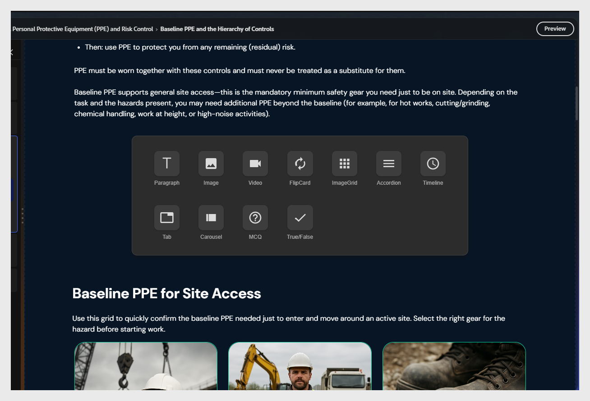
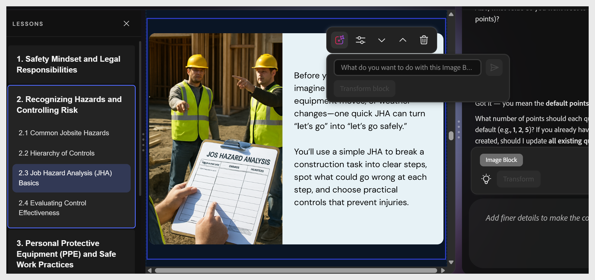

# 콘텐츠 구성 요소 추가

두 개의 기존 요소 중에서 선택합니다. + 버튼이 표시됩니다. 구성 요소 선택기를 열려면 선택합니다.

사용 가능한 구성 요소:

<table>
  <thead>
    <tr>
      <th>구성 요소</th>
      <th>다음에 사용:</th>
    </tr>
  </thead>
  <tbody>
    <tr>
      <td><strong>단락</strong></td>
      <td>본문 텍스트 및 설명</td>
    </tr>
    <tr>
      <td><strong>이미지</strong></td>
      <td>일러스트레이션, 스크린샷, 다이어그램</td>
    </tr>
    <tr>
      <td><strong>비디오</strong></td>
      <td>포함된 MP4 또는 연결된 비디오</td>
    </tr>
    <tr>
      <td><strong>카드 뒤집기</strong></td>
      <td>용어 또는 정의 쌍, 상호 작용 표시</td>
    </tr>
    <tr>
      <td><strong>이미지 그리드</strong></td>
      <td>격자 레이아웃의 여러 이미지</td>
    </tr>
    <tr>
      <td><strong>아코디언</strong></td>
      <td>확장 가능한 섹션, 단계별 절차</td>
    </tr>
    <tr>
      <td><strong>타임라인</strong></td>
      <td>순차적 이벤트 또는 프로세스 단계</td>
    </tr>
    <tr>
      <td><strong>웹 개체</strong></td>
      <td>주제 슬라이드 내에 외부 웹 콘텐츠, 웹 페이지, 대화형 도구, 설문조사 또는 웹 응용 프로그램 포함</td>
    </tr>
    <tr>
      <td><strong>탭</strong></td>
      <td>병렬 컨텐츠 — 비교, 지역 변형</td>
    </tr>
    <tr>
      <td><strong>슬라이드</strong></td>
      <td>이미지 또는 콘텐츠 카드의 전환 가능 시리즈</td>
    </tr>
    <tr>
      <td><strong>MCQ</strong></td>
      <td>인라인 비등급 지식 검사</td>
    </tr>
    <tr>
      <td><strong>참/거짓</strong></td>
      <td>인라인 비등급 참 또는 거짓 검사</td>
    </tr>
  </tbody>
</table>

>[!NOTE]
>
>학습자가 자신의 속도를 제어할 수 있는 단계별 절차에는 **아코디언**&#x200B;을 사용하세요. 용어 또는 정의 내용에 **카드 뒤집기**&#x200B;를 사용하십시오.

## Content Composer 강의에 웹 개체 추가

웹 개체는 강의 내 인라인 프레임에 외부 콘텐트를 표시합니다. 학습자는 강의를 종료하지 않고도 콘텐츠와 상호 작용할 수 있습니다. 대화형 도구, 포함된 양식, 설문 조사 또는 iframe 포함을 지원하는 모든 웹 기반 리소스에 대해 이 기능을 사용할 수 있습니다.

### 웹 개체 추가

1. 콘텐츠 컴포저에서 강의를 열고 웹 개체를 추가할 항목으로 이동합니다.
2. 항목 슬라이드에 있는 두 개의 기존 요소 중에서 선택합니다. **+** 단추가 표시됩니다.
3. **+**&#x200B;을(를) 선택하여 구성 요소 선택기를 엽니다.
4. **웹 개체**&#x200B;를 선택합니다. 캔버스에 블록이 표시됩니다.

### 웹 개체 구성

웹 개체 차단 도구 모음에서 **설정** 아이콘을 선택하여 구성 패널을 엽니다.

### 콘텐츠 소스 설정

**콘텐츠**&#x200B;에서 외부 콘텐츠 로드 방식을 선택합니다.

- **URL** - 포함할 페이지나 도구의 웹 주소를 입력합니다. 인라인 프레임의 강의 내에 콘텐츠가 로드됩니다.
- **임베드 코드** - 서드파티 서비스에서 임베드 스니펫을 붙여넣습니다. 대화형 양식, 설문 조사 또는 미디어 플레이어와 같이 고유한 임베드 코드를 제공하는 도구에 이 표를 사용하십시오.
- **시스템** - 연결된 시스템 또는 통합에서 콘텐츠를 선택합니다.

### 프레임 Height 설정

**프레임 Height** 필드에서 포함된 콘텐츠 프레임의 Height을 픽셀 단위로 설정합니다. **+** 및 **−** 컨트롤을 사용하여 값을 조정합니다. 기본값은 498px입니다.

포함된 내용의 원래 Height에 맞게 프레임 Height을 조정합니다. 값을 너무 낮게 설정하면 프레임 안에 스크롤 막대가 추가되고 너무 높게 설정하면 콘텐츠 아래에 공백이 추가됩니다.

### 로드 및 표시 옵션 구성

- **자동 로드** - 선택하면 학습자가 슬라이드에 도달할 때 웹 콘텐츠가 자동으로 로드됩니다. 강의 속도가 느려지지 않도록 내용이 많은 페이지에 대해 이 옵션의 선택을 취소하십시오. 자동 로드가 꺼져 있으면 학습자는 프레임을 선택하여 로드를 트리거합니다.
- **블록 제목** - 웹 개체 블록 위에 제목을 표시하도록 전환합니다. 이를 통해 학습자가 상호 작용하기 전에 포함된 콘텐츠에 대한 컨텍스트를 제공할 수 있습니다.

## 주제 내에서 내용 블록 이동

도구 모음의 편집 옵션이나 AI를 사용하여 주제 내 콘텐츠 블록을 재정렬할 수 있습니다.

