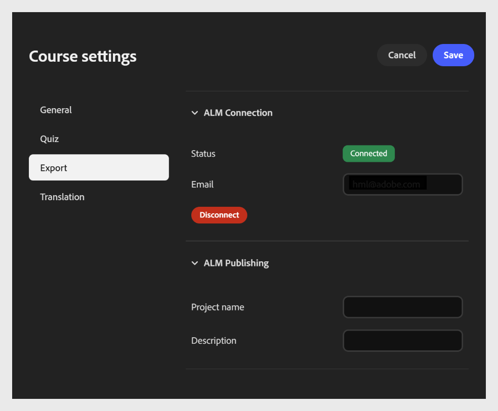
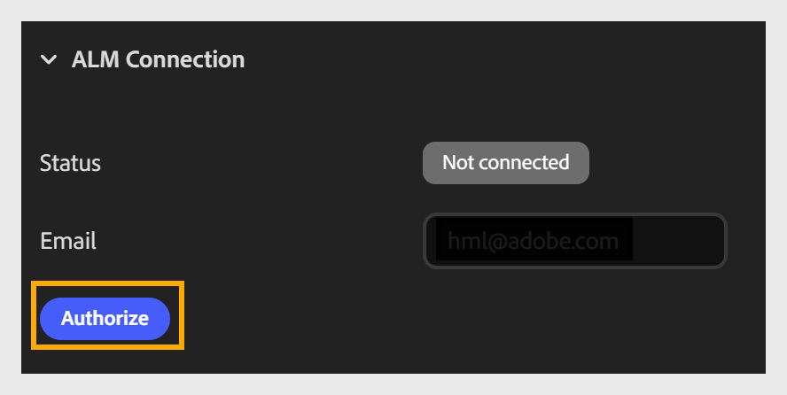
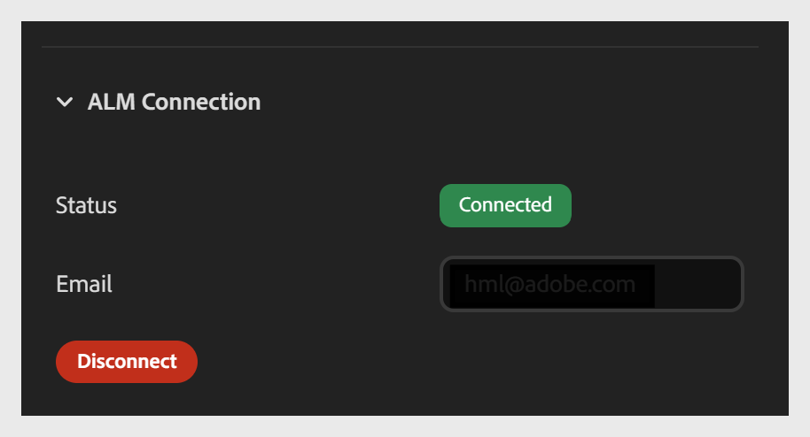

# 콘텐츠 컴포저에서 Adobe Learning Manager으로 과정 Publish

**내보내기** 탭을 사용하면 과정을 Adobe Learning Manager(ALM)에 연결하고 ALM 콘텐츠 라이브러리에 바로 게시할 수 있습니다. 연결을 설정하려면 **전자 메일** 필드에 전자 메일을 입력하십시오. 동일한 이메일 로그인 ID로 ALM 계정이 있는지 확인합니다. 연결되면 과정을 ALM에 모듈로 게시할 수 있습니다.

이 연결은 강의당 1회 설정입니다. 설정이 완료되면 게시하거나 내보낼 때마다 다시 연결할 필요가 없습니다.

여기에는 두 가지 섹션이 있습니다.

- ALM 연결 섹션

- ALM 게시 섹션

**내보내기 설정을 구성하려면**

1. **과정 설정**&#x200B;을 열고 왼쪽에 있는 **내보내기** 탭을 선택합니다.

2. **ALM 연결** 섹션을 확장합니다(아직 확장되지 않은 경우).

   - Adobe Learning Manager 계정과 연결된 **이메일** 주소를 입력하세요.

   - **승인**을 선택하여 로그인하고 과정을 ALM 계정에 연결합니다.
     

   - 권한이 부여되면 **연결 해제**&#x200B;에서 **연결됨**(으)로 **상태** 필드 업데이트를 확인하십시오.
     

## Adobe Learning Manager 게시 세부 정보

계정에 연결한 후 ALM 게시 섹션에서 게시 세부 정보를 구성합니다.

- 강의를 식별하려면 **프로젝트** 이름을 입력하십시오. 이 이름은 ALM 콘텐츠 라이브러리에 강의 제목으로 나타납니다.

- ALM 콘텐츠 라이브러리에 있는 강의와 함께 나타나는 강의의 간단한 요약인 **설명**&#x200B;을 입력하여 학습자와 책임자가 강의의 목적을 이해할 수 있도록 도와줍니다.

- ALM 콘텐츠 라이브러리에 과정을 모듈로 보내려면 **Publish**&#x200B;을 선택하십시오.

## 게시된 Content Composer 강의의 학습자 탐색

학습자가 축소 가능한 목차 및 모바일 탐색을 포함하여 Adobe Learning Manager에 게시되거나 SCORM 패키지로 내보낸 Content Composer 강의를 탐색하는 방법에 대해 알아봅니다.

## 축소 가능한 목차

Adobe Learning Manager에 게시되거나 SCORM 패키지로 내보내지는 강의에는 축소 가능한 강의와 주제 탐색 패널이 있습니다.

학습자는 다음을 수행할 수 있습니다.

- 탐색 패널을 **확장**&#x200B;하여 수업과 주제를 찾아보고 모든 섹션으로 이동합니다.
- 탐색 패널을 축소하여 **화면 공간을 차지하는 패널 없이 강의 콘텐츠에 집중합니다**.
학습자가 강의를 진행하면 패널 상태가 유지됩니다.

## 모바일 탐색

모바일 장치에서 튜토리얼 및 항목 탐색이 측면 패널이 아닌 전체 화면 오버레이로 열립니다. 학습자는 탐색 아이콘을 선택하여 오버레이를 열고 원하는 강의나 주제를 탐색한 다음 선택합니다.

학습자가 대상을 선택하면 오버레이가 자동으로 닫혀 과정 콘텐츠로 돌아갑니다.
