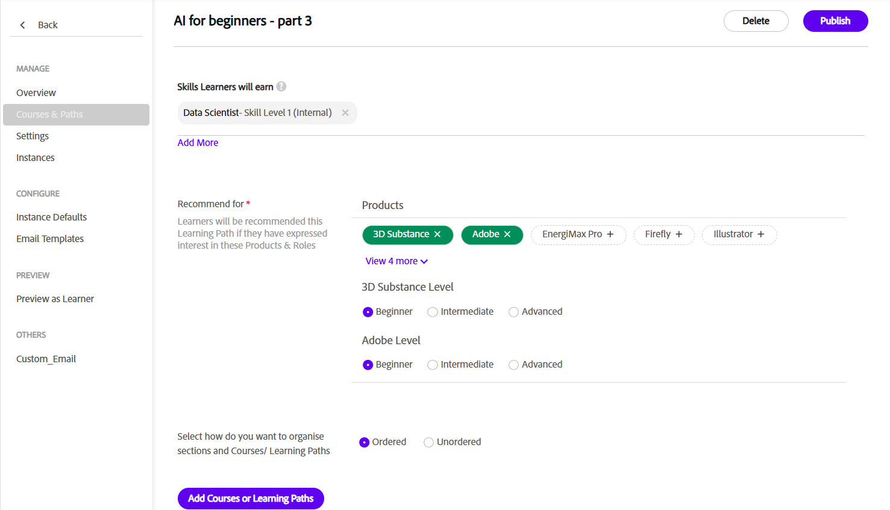

# 학습 경로 만들기

작성자는 학습자가 사용할 학습 경로를 생성할 수 있습니다. 작성자 앱에서 학습 경로를 만들려면 다음을 수행하십시오.

1. **작성자**(으)로 로그인합니다.
1. **학습** > **학습 경로**&#x200B;를 선택합니다.
1. **추가**&#x200B;를 선택합니다.

   

1. **학습 경로 이름**: 학습 경로 이름을 입력하십시오.
1. **학습 경로 개요**: 학습 경로에 대한 간략한 개요를 입력하십시오.
1. **이 학습 경로의 이점**: 학습 경로의 몇 가지 이점에 대해 설명합니다.
1. **태그**: 미리 정의된 목록에서 적절한 태그를 선택합니다.
1. **고유 학습 개체 ID**: 학습 개체의 고유 ID를 입력하십시오.
1. **등록 유형**: 드롭다운 메뉴에서 등록 유형을 선택합니다.
1. **요금제**: **결제** 또는 **무료**&#x200B;를 선택합니다. **무료**&#x200B;를 선택하면 **학습 경로 가격** 상자가 비활성화됩니다.
1. **등록 취소**: 학습자가 스스로 등록을 취소할 수 있도록 하려면 이 옵션을 선택합니다.
1. **표지 이미지**: 학습 경로에 대한 표지 이미지를 선택합니다.
1. **배너 이미지**: 학습 경로에 대한 배너 이미지를 선택합니다.
1. **카탈로그 선택**: 목록에서 관련 카탈로그를 선택하십시오.
1. **준수 레이블**: 목록에서 적절한 준수 레이블을 선택합니다.
1. **레이블**: 목록에서 적절한 레이블을 선택합니다.
1. **신뢰할 수 있는 배지 ID**: 목록에서 적절한 레이블을 선택합니다.
1. **난이도**: 목록에서 적절한 난이도를 선택합니다.
1. **준수**: 목록에서 적절한 준수 수준을 선택합니다.

   >[!NOTE]
   >
   > 저장하기 전에 언제든지 **새 언어 추가** 탭을 선택하고 목록에서 언어를 선택한 다음 **저장**&#x200B;을 선택하여 새 언어를 추가할 수 있습니다. 기본 언어는 영어입니다.

   

1. **저장**&#x200B;을 선택합니다. 학습 경로의 이름이 지정된 새 페이지가 나타납니다. 이제 스킬과 제품을 추가하고, 섹션을 구성하고, 강의 또는 학습 경로를 추가할 수 있습니다.

   

1. **스킬 학습자가 획득합니다**&#x200B;를 선택합니다. 섹션이 열리면 학습자가 습득할 스킬과 해당 레벨을 선택합니다.

   

1. **추가**&#x200B;를 선택합니다.
1. 섹션과 강의 또는 학습 경로를 구성하는 방법을 선택합니다. **정렬됨** 또는 **정렬되지 않음**&#x200B;을 선택합니다.
1. 다음으로 **강의 또는 학습 경로 추가**&#x200B;를 선택합니다. 기존 강의와 학습 경로가 있는 창이 나타납니다. 각 타일에는 이름, 유형(강의 또는 학습 경로), 게시 상태 및 강의 형식이 표시됩니다. 강의인 경우 자가 진행식, 가상, 강의실 또는 혼합 등의 유형이 표시됩니다. 학습 경로인 경우 강의 수가 표시됩니다.

   

1. 학습 경로에 추가할 강의나 학습 경로를 선택합니다.

   

1. **추가**&#x200B;를 선택합니다. 강의 및 학습 경로가 학습 경로 페이지에 표시됩니다.

   

1. **스킬 학습자가 획득합니다**&#x200B;를 선택합니다. 스킬과 레벨을 선택합니다. **추가**&#x200B;를 선택합니다.
1. 목록에서 제품을 선택한 다음 해당 수준을 선택하여 학습 경로를 제품에 매핑합니다.

   >[!NOTE]
   >
   > 제품을 하나 이상 선택하지 않으면 학습 경로를 게시할 수 없습니다.

   

1. 섹션과 강의 또는 학습 경로를 구성하는 방법을 선택합니다. **정렬됨** 또는 **정렬되지 않음**&#x200B;을 선택합니다.
1. **섹션 제목 추가**&#x200B;를 선택한 다음 섹션 제목을 입력합니다.

   

1. **제출**&#x200B;을 선택합니다.
1. 학습 경로를 필수 항목으로 만들려면 **필수**&#x200B;를 선택합니다. 선택하지 않으면 학습 경로가 선택 사항이 됩니다.
1. 학습 경로가 다른 섹션을 추가하려면 24~30단계를 반복합니다.
1. **완료 요구 사항**: 목록에서 **모두** 또는 숫자를 선택하여 교육을 완료하십시오.
1. 순서를 변경하려면 강의를 위 또는 아래로 이동합니다.
1. 학습 경로에서 강의를 제거하려면 강의 카드에서 **X**&#x200B;을(를) 선택합니다.
1. **Publish**&#x200B;을 선택합니다. 새로 게시된 학습 경로를 보려면 **학습 경로** 페이지로 돌아가십시오.
