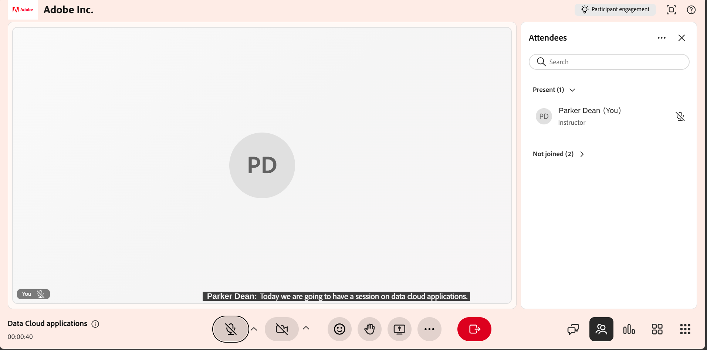

# 폐쇄 자막 이해

폐쇄 캡션은 라이브 허브 세션 중에 자동으로 생성되고 참석자의 설명에 따라 지속적으로 업데이트됩니다. 캡션은 전용 표시 영역에 표시되며 **회의실 설정**&#x200B;에서 강사가 선택한 언어로 표시됩니다.

강사와 참가자 모두 캡션을 볼 수 있습니다. 각 참석자는 다른 참석자의 캡션 설정에 영향을 주지 않고 독립적으로 캡션을 표시하거나 숨길 수 있습니다.

강사만 캡션 언어를 변경할 수 있습니다. 참가자는 강사가 선택한 언어로 캡션만 볼 수 있습니다. 참가자는 캡션의 언어를 변경할 수 없습니다.

## Live Hub가 캡션 언어를 결정하는 방법

Live Hub는 다음 우선 순위에 따라 캡션 언어를 자동으로 선택합니다.

1. **과정 언어:** Live Hub는 캡션에 대해 지원되는 과정 언어를 사용합니다. 다국어 강의의 경우, 현재 강의 인스턴스가 폐쇄 자막을 지원하지 않는 언어를 사용하는 경우, 라이브 허브는 폐쇄 자막을 지원하는 첫 번째 강의 인스턴스의 언어를 선택합니다. 자세한 내용은 ALM에서 [지원되는 언어](../../migrated/languages-supported.md)를 참조하세요.
1. **계정 언어:** 과정 언어가 지원되지 않으면 Live Hub에서 계정 언어를 확인하고 지원되는 경우 사용합니다.

>[!NOTE]
>
>강의 언어와 계정 언어가 모두 지원되지 않으면 Live Hub에서 캡션 언어로 영어를 선택합니다. 또한 캡션은 기본적으로 꺼져 있으며 수동으로 활성화해야 합니다.

## 폐쇄 캡션에 지원되는 언어

라이브 허브는 다음 언어로 폐쇄 캡션을 지원합니다.

* 영어로만
* 프랑스어
* 독일어
* 중국어
* 스페인어
* 이탈리아어
* 일본어
* 포르투갈어
* 덴마크어
* 네덜란드어
* 핀란드어
* 튀르키예어
* 한국어
* 노르웨이어
* 스웨덴어
* 러시아어

## 폐쇄 캡션 작동 방식

Live Hub 세션에서 폐쇄 캡션이 자동으로 생성됩니다. 캡션은 전용 패널에 표시되고 참가자가 말할 때 계속 업데이트됩니다. 강사와 학습자 모두 캡션을 볼 수 있습니다.

각 참가자는 원하는 대로 캡션을 표시하거나 숨길 수 있습니다. 이 설정을 변경해도 다른 참가자는 영향을 받지 않습니다.

*세션의 폐쇄 자막을 표시하는 Live Hub 인터페이스*

## 역할 및 권한

**폐쇄 캡션** 기능은 라이브 허브 세션에서 강사와 학습자 모두 사용할 수 있습니다. 사용 가능한 작업은 사용자 역할에 따라 다릅니다.

| **강사** | **학습자** |
|---|---|
| [폐쇄 캡션 표시](../getting-started-with-live-hub/manage-closed-captions-as-an-instructor.md#display-closed-captions) | [폐쇄 캡션 표시](../getting-started-with-live-hub/manage-closed-captions-as-a-learner.md#display-closed-captions) |
| [폐쇄 캡션의 모양 변경](../getting-started-with-live-hub/manage-closed-captions-as-an-instructor.md#change-the-appearance-of-closed-captions) | [폐쇄 캡션의 모양 변경](../getting-started-with-live-hub/manage-closed-captions-as-a-learner.md#change-the-appearance-of-closed-captions) |
| [캡션 언어 선택](../getting-started-with-live-hub/manage-closed-captions-as-an-instructor.md#select-the-caption-language) | |