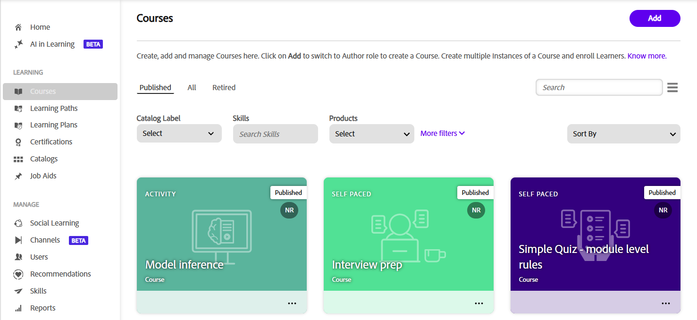

# 세션 초대 다시 보내기

## 개요

>[!NOTE]
>
>다시 트리거는 가상 강의실(VC) 세션에만 사용할 수 있습니다. 강의실 및 자가 진행식(e-러닝) 모듈과 같은 다른 모듈 유형은 지원되지 않습니다.

학습자는 몇 가지 이유로 초대를 놓칠 수 있습니다. **재전송** 옵션을 사용하면 강의를 편집할 수 있는 권한이 있는 관리자는 인스턴스 페이지에서 VC 세션을 열고, 학습자를 검색하고, 세션 초대 이메일을 보낼 수 있습니다. Learning Manager에서 등록 이벤트 과정 외부에서 온디맨드로 전자 메일을 보냅니다. 학습자는 세션 세부 정보 및 일정 초대를 수신하고 등록 상태는 동일하게 유지됩니다.

## 사용 사례

다음은 세션 초대를 재전송하는 사용 사례입니다.

* **누락된 초대를 복구합니다.** 사서함이 가득 찼거나, 전자 메일이 스팸으로 전송되었거나, 원본 전자 메일이 전달되지 않은 학습자에게 초대를 다시 보냅니다.
* **노쇼 축소** 세션 직전 또는 세션 당일 세션 세부 정보와 일정 초대를 재전송합니다.
* **등록 해결 방법을 사용하지 마세요.** 등록 상태와 세션 등록을 그대로 유지하려면 학습자를 등록 취소하거나 다시 등록하지 않고 초대를 다시 보냅니다.
* **지원 티켓을 줄이세요.** 관리자는 지원 팀을 거치지 않고 &quot;누락된 초대&quot; 요청을 직접 해결합니다.

## 사전 요구 사항

* 세션은 VC 세션입니다.
* 학습자는 대상 세션에 등록됩니다. Learning Manager는 세션에 등록한 학습자에게만 초대를 보냅니다.
* 세션이 이미 있습니다. 이 기능은 세션을 생성하거나 수정하지 않습니다.
* 기존 세션 초대 이메일 템플릿을 사용합니다. 이 기능은 새 전자 메일 템플릿을 도입하지 않습니다.

## 지원되는 구성

| 항목 | 지원 |
|--------------------|-----------------------------------------------------------------------------------------------------------|
| 역할 | 강의 편집 권한이 있는 관리자 할당된 세션의 강사. |
| 카탈로그 항목 유형 | 강의 및 학습 경로 |
| 모듈 유형 | 가상 강의실(VC) 세션 |
| 세션 | 현재 및 향후 세션 지난 세션은 지원되지 않습니다. |
| VC 공급자 | Zoom, Teams, Adobe Connect 등 세션에 대해 구성된 모든 공급자 |
| 이메일 템플릿 | 학습 개체용으로 구성된 템플릿: 세션 세부 정보 이메일 및 일정 초대 |
| 수신자 | 세션에 등록된 개별 학습자입니다. 사용자 그룹은 지원되지 않습니다. |
| 트리거 | 수동, 세션 초대 재전송 작업 |

관리자 역할은 이번 릴리스에서 이 기능에 액세스할 수 없습니다. 이 옵션은 학습자와 관리자에게 표시되지 않습니다.

## 세션 초대 다시 보내기 작업에 액세스

작업의 위치는 사용자의 역할에 따라 다릅니다.

| 역할 | 액션을 찾을 위치 |
|---------------|-----------------------------------------------------------------------------------------------------------------------------------------------------------------------------------------------------------------|
| 책임자 | 카탈로그에서 강의 또는 학습 경로를 열고, 인스턴스로 이동하여 인스턴스를 엽니다. 세션 섹션에서 VC 세션을 찾은 다음 세션 초대 재전송 을 선택합니다. 강의를 편집하려면 권한이 필요합니다. |

## 다시 보내기 대화 상자

[세션 초대 재전송] 대화 상자에는 다음 요소가 포함되어 있습니다.

| 요소 | 설명 |
|-----------------|---------------------------------------------------------------------------------------------------------------------------------------------------------------------------------------------------------------------------------------------------------------------------------------------------------------------------|
| 학습자 선택 | 검색 필드. 학습자의 이름이나 전자 메일 주소를 입력하여 학습자를 찾은 다음 학습자를 선택합니다. 둘 이상의 학습자를 선택할 수 있습니다. 참고: 선택된 각 학습자는 학습 개체용으로 구성된 템플릿에 따라 세션 세부 정보 전자 메일과 일정 초대라는 두 개의 전자 메일을 수신합니다. |
| 취소 | 전자 메일을 보내지 않고 대화 상자를 닫습니다. |
| 다시 전송 | 선택한 학습자에게 전자 메일을 보냅니다. 이 버튼은 학습자를 한 명 이상 선택할 때까지 비활성화됩니다. |

>[!NOTE]
>
>이 검색은 개별 학습자만 일치시킵니다. 사용자 그룹을 검색하거나 선택할 수 없습니다.

## 세션 초대 다시 보내기

관리자 권한으로 다음 단계를 완료하십시오.

1. 강의 편집 권한이 있는 관리자로 로그인합니다.
2. **학습** > **과정**&#x200B;으로 이동합니다.

   

3. 인스턴스에 액세스하려는 강의를 엽니다.

   

4. 액세스할 세션이 있는 인스턴스로 이동합니다.
5. 아래의 **세션 세부 정보** 섹션에서 **세션 초대 재전송**&#x200B;을 선택합니다.

   

6. **세션 초대 재전송** 팝업이 열립니다.

   

7. 초대를 재보낼 학습자를 검색합니다.

   

   

8. **재전송**&#x200B;을 선택합니다. &quot;세션 초대가 &quot;x&quot; 학습자에게 전송되었습니다&quot;라는 메시지가 표시됩니다.

   

9. 선택한 학습자 중 한 명이 다른 세션에서 온 경우 &quot;선택한 학습자 X명이 이 세션에 등록되지 않았으며 건너뜀&quot;이라는 메시지가 표시됩니다.

   

10. 몇 분 후에 학습자는 세션 참가 링크를 포함한 세션 세부 정보가 포함된 메일을 받게 됩니다.

Learning Manager는 선택한 각 학습자가 대상 세션에 등록되어 있는지 확인한 다음 기존 세션 초대를 적격 학습자에게 보냅니다.

Learning Manager가 요청을 수락하면 대화 상자가 닫히고 &quot;초대 이메일이 세션 학습자에게 전송됩니다. 완료하는 데 시간이 걸릴 수 있습니다.&quot; 이메일은 보통 몇 분 안에 도착합니다.

## 전자 메일 콘텐츠

선택된 각 학습자는 세션 세부 정보 전자 메일과 세션에 대한 일정 초대를 받습니다. 콘텐츠에는 VC 세션 참가 링크, 날짜 및 시간, 세션 세부 정보가 포함됩니다. Learning Manager는 동일한 템플릿을 사용하므로 전자 메일은 원본 세션 초대와 동일합니다.

## 다중 등록 동작

재전송 은 인스턴스에 따라 다릅니다. 학습자가 둘 이상의 인스턴스에 등록된 경우 하나의 인스턴스에서 다시 전송하면 해당 인스턴스에 대한 초대만 전송됩니다. 학습자의 다른 인스턴스에 대한 초대는 다시 트리거되지 않습니다.

| 학습자 등록 | 액션 | 결과 |
|------------------------------------------------|------------------------------------------------|----------------------------------------------------------------------------------|
| 인스턴스 A 및 인스턴스 B | 인스턴스 A에서 다시 보내기 | A 초대 인스턴스만 재전송됩니다. |
| 인스턴스 A만 | 인스턴스 A에서 다시 보내기 | A 초대가 재전송되었습니다. |
| 선택한 세션과 다른 인스턴스 | 학습자가 강의 레벨 검색에 나타납니다 | Learning Manager가 선택한 세션의 학습자를 건너뛴 후 경고를 표시합니다. |

## 특정 시나리오에서의 동작

| 시나리오 | 비헤이비어 |
|--------------------------------------------------------|------------------------------------------------------------------------------------------------------------------------------------------------------------------------------------------------------------------------------|
| 인스턴스에 VC 세션이 없음 | 세션 초대 다시 보내기 작업을 사용할 수 없습니다. |
| 세션이 이미 발생했습니다. | 작업을 사용할 수 없습니다. Learning Manager는 현재 및 향후 세션만 지원합니다. |
| 세션에 등록되지 않은 학습자를 선택합니다 | 학습자 검색은 전체 강의를 다루므로 다른 사례의 학습자를 찾을 수 있습니다. Learning Manager는 선택한 세션에 등록되지 않은 학습자를 건너뛰고 다른 학습자에게 초대를 전송하고 경고를 표시합니다. |
| 학습자가 여러 인스턴스에 등록되었습니다 | Learning Manager는 사용자가 보낸 인스턴스에 대해서만 초대를 보냅니다. 다른 인스턴스에 대한 초대는 전송되지 않습니다. |
| 학습 경로 인스턴스 선택 | 동작은 강의 인스턴스와 동일한 방식으로 작동합니다. |

## 오류 처리

오류가 발생하여 Learning Manager에서 전자 메일을 보내지 못하는 경우 대화 상자에 다음 메시지 중 하나가 표시됩니다.

| 조건 | 메시지 |
|---------------------------------------|------------------------------------------------------------------------|
| 초대 이메일 템플릿을 사용할 수 없음 | 이메일을 보낼 수 없습니다. 초대 이메일 템플릿이 현재 비활성화되어 있습니다. |
| 기타 오류 | 전자 메일을 보내는 동안 오류가 발생했습니다. 나중에 다시 시도하십시오. |

세션에 등록되지 않은 학습자를 선택하면 Learning Manager에 해당 학습자에 대한 초대를 건너뛰었다는 경고가 표시됩니다. 등록된 학습자에게 초대가 계속 전송됩니다.

>[!NOTE]
>
>전자 메일 서비스는 대화 상자가 닫힌 후 배달 상태를 Learning Manager에 비동기적으로 보고합니다.

## 제한 사항

* 현재 및 향후 세션에 대해서만 초대를 재보낼 수 있습니다.
* 학습 객체에 대해 구성된 템플릿만 사용됩니다. 다른 템플릿을 선택할 수 없습니다.
* 한 번에 한 세션에 대한 초대를 다시 보낼 수 있습니다. 한 번에 여러 인스턴스에서 다시 전송하는 기능은 지원되지 않습니다.
* 사용자 그룹을 선택할 수 없습니다. 개별 학습자만 선택할 수 있습니다.
* Learning Manager에서는 선택한 세션에 등록한 학습자에게만 초대를 보냅니다.
* 이 대화 상자에 전자 메일의 전송 상태가 표시되지 않으며 개별 학습자에 대한 다시 시도가 제공되지 않습니다.
* 대화 상자에서 새 세션을 예약하거나 기존 세션 세부 정보를 편집할 수 없습니다.

## 문제 해결

| 증상 | 가능한 원인 | 액션 |
|---------------------------------------------------------------------|-------------------------------------------------------------------------------------------------------------------|---------------------------------------------------------------------------------------------------------------------|
| 세션 초대 재전송 작업이 표시되지 않습니다 | 모듈이 VC 세션이 아니거나 세션이 이미 발생했거나 강의를 편집할 수 있는 권한이 없습니다. | 세션이 현재 또는 향후 VC 세션인지 확인합니다. 관리자에게 강의 권한 확인을 요청하십시오. |
| 전자 메일을 보내면 경고가 표시됩니다 | 선택한 한 명 이상의 학습자가 선택한 세션에 등록되어 있지 않습니다. | 세션에 등록된 학습자를 확인하고 올바른 세션 또는 인스턴스에서 초대를 다시 보냅니다. |
| 잘못된 인스턴스에 대해 초대가 전송됨 | 학습자가 여러 인스턴스에 등록되었으며 다른 인스턴스에서 초대를 재전송했습니다. | 학습자에게 필요한 인스턴스를 열고 여기에서 초대를 다시 보냅니다. |
| &quot;초대 이메일 템플릿을 현재 사용할 수 없음&quot; 오류가 표시됩니다 | 학습 개체에 대한 초대 이메일 템플릿이 비활성화됩니다. | 관리자에게 템플릿을 활성화한 다음 초대를 다시 보내라고 요청합니다. |
| 보낸 전자 메일은 원래 초대와 동일하게 보입니다. | 이것은 예상된 일입니다. Learning Manager가 기존 세션 초대 템플릿을 재사용합니다. | 조치가 필요하지 않습니다. |
| 여러 인스턴스에서 한 번에 초대를 다시 보내야 합니다 | 지원되지 않습니다. | 각 인스턴스에서 개별적으로 초대를 다시 보냅니다. |
| 강의실 또는 e-러닝 모듈에 대한 초대를 다시 보내야 합니다 | 지원되지 않습니다. 다시 트리거는 VC 세션에만 사용할 수 있습니다. | 이러한 모듈 유형에 사용할 수 있는 작업이 없습니다. |
| 학습자가 이메일이 도착하지 않았다고 말합니다 | 전자 메일이 아직 처리 중이거나, 학습자의 사서함이 가득 찼거나, 전자 메일이 스팸으로 필터링되었습니다. | 몇 분 정도 기다렸다가 학습자에게 스팸 폴더를 확인하고 사서함 공간을 확보한 다음 초대를 다시 보내라고 요청하십시오. |
