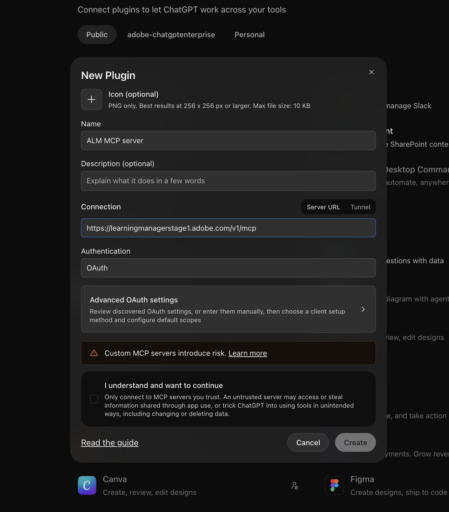

# Adobe Learning Manager MCP 서버 구성

조직에 대해 MCP(모델 컨텍스트 프로토콜) 서버를 한 번 구성합니다. 구성에는 두 가지 부분이 있습니다. Learning Manager에서 MCP 서버를 만든 다음 이를 AI 도우미에 연결합니다. 이후 학습자는 AI 어시스턴트에서 Learning Manager에 로그인하고 MCP 도구를 사용할 수 있습니다.

시작하기 전에 다음 사항을 확인하십시오.

* MCP 서버가 Learning Manager 계정에 대해 활성화됩니다. 이를 활성화하려면 Adobe 고객 성공 관리자 또는 Adobe 지원에 문의하십시오. 그때까지 모든 요청은 403 Forbidden을 반환합니다.
* AI 관리자 는 해당 플랫폼에서 커넥터를 추가하고 구성할 수 있는 권한이 있습니다.

**전제 조건:** 모델 컨텍스트 프로토콜 서버는 Ultimate 계층 계정에서만 작동하는 백엔드 플래그 기반 기능입니다.

## Learning Manager에서 MCP 서버 만들기

MCP 서버를 만들면 OAuth 응용 프로그램이 설정되며 MCP 서버 URL, 클라이언트 ID 및 클라이언트 암호가 제공됩니다.

1. Learning Manager에 통합 책임자로 로그인합니다.
2. 탐색 메뉴에서 **MCP 서버**&#x200B;를 선택합니다.
3. 오른쪽 상단에서 **만들기**&#x200B;를 선택합니다.

   

4. **응용 프로그램 세부 정보** 페이지에서 다음을 입력한 후 **다음**&#x200B;을 선택합니다.

   * **응용 프로그램 이름:** 최대 50자를 입력하십시오(예: Claude의 경우 ALM). 학습자는 연결을 승인하면 이 이름이 표시되므로 인식하는 이름을 선택합니다.
   * **리디렉션 도메인:** 각 AI 길잡이의 콜백 도메인을 한 줄에 하나씩 입력하십시오. 패스를 포함하지 않고 각각 시작합니다. 이 필드는 필수입니다.
   * **설명:** 최대 150자를 입력합니다. 예를 들어, 학습자가 Claude의 ALM을 사용할 수 있도록 허용합니다.

5. **도구 구성** 페이지에서 AI 도우미가 각 도구를 언제 호출할지 결정하는 데 사용하는 도구와 설명을 검토합니다. 설명을 변경하려면 **동작**(**...**) \> **편집**&#x200B;을 선택하세요. 기본값을 복원하려면 **다시 설정**&#x200B;을 선택하십시오. 그런 다음 **다음**&#x200B;을 선택합니다.
6. **클라이언트 자격 증명** 페이지에서 **MCP 서버 URL**, **클라이언트 ID** 및 **클라이언트 암호**&#x200B;를 복사합니다. 안전하게 보관하십시오. AI 비서를 연결하는 데 필요합니다.

MCP 서버는 항상 학습자 범위를 가지므로 선택할 범위가 없습니다.

연결하려는 각 AI 어시스턴트에 대해 도메인을 등록합니다.

| **AI 도우미** | **등록하도록 도메인 리디렉션** | **전체 콜백 URL(참조)** |
|----|----|----|
| 클로드 | [https://claude.ai](https://claude.ai/) 및 [https://claude.com](https://claude.com/) | <https://claude.ai/api/mcp/auth_callback> |
| Chatgpt | [https://chatgpt.com](https://chatgpt.com/) | <https://chatgpt.com/connector/oauth/&lt;id>\> (ChatGPT는 설치하는 동안 ID를 표시함) |

[https://chatgpt.com](https://chatgpt.com/)과 같은 정확한 도메인을 등록합니다. [https://*chatgpt.com*](https://chatgpt.com)*과(와) 같은 부분 와일드카드는 관련 없는 도메인과 일치할 수 있으므로 사용하지 마십시오. 하위 도메인을 허용하려면* [*https://*.example.com](https://.example.com)과 같은 전체 레이블 와일드카드를 사용하십시오.

모든 리디렉션 도메인을 나열하는 경우 하나의 MCP 서버가 여러 AI 도우미를 제공할 수 있습니다. 다른 도우미에 영향을 주지 않고 하나의 도우미에 대한 액세스 권한을 취소하려면 각각에 대해 별도의 MCP 서버를 만듭니다. 모든 서버는 동일한 MCP 서버 URL을 사용합니다.

MCP 서버 URL만 있으면 됩니다. 클라우드 및 ChatGPT는 Learning Manager OAuth 끝점을 자동으로 검색합니다. 수동 설정의 경우 Learning Manager MCP 서버에 대한 **OAuth 끝점**&#x200B;을 확인하십시오.

## Claude Pro 또는 Max 연결

이러한 단계가 더 이상 인터페이스와 일치하지 않으면 Claude 문서를 참조하십시오.

>[!NOTE]
>
>Answer_learning_content_question 도구의 응답이 클라이언트에 의해 재구성되고 형식이 지정됨에 따라 질문에 대한 응답의 세부 묘사가 변경됩니다.

1. 클라우드에서 **사용자 지정** \> **커넥터**&#x200B;로 이동합니다.
2. **추가**(+)를 선택한 다음 **사용자 지정 커넥터 추가**&#x200B;를 선택합니다.
3. 커넥터 세부 정보를 입력한 다음 **계속**&#x200B;을 선택합니다.

   * **이름:** 학습자가 인식할 수 있는 이름(예: Adobe Learning Manager)을 입력합니다.
   * **원격 MCP 서버 URL:** 클라이언트 자격 증명 페이지의 MCP 서버 URL을 [https://\[alm-host\]/v1/mcp](https://[alm-host]/v1/mcp) 형식으로 입력하십시오.

4. **인증**&#x200B;에서 **지금 로그인**&#x200B;을 유지합니다. Claude는 Learning Manager OAuth 설정을 읽고 일치하는 옵션을 *검색됨*&#x200B;으로 표시합니다.
5. **OAuth 클라이언트**&#x200B;에서 **자신의 OAuth 클라이언트 사용**&#x200B;을 선택합니다. **클라이언트 ID** 및 **클라이언트 암호**&#x200B;을 붙여넣습니다.
6. **추가**&#x200B;를 선택합니다. Claude가 Learning Manager 로그인 페이지를 엽니다. 로그인하면 커넥터가 연결된 것으로 표시됩니다.

>[!NOTE]
>
>Claude는 클라이언트 암호 필드를 선택 사항으로 표시하지만 Learning Manager에서는 필수입니다. 비워 두거나 잘못된 값을 입력하면 &quot;인증 실패&quot; 메시지와 함께 로그인이 실패합니다.

## 클라우드 팀 또는 기업 연결

조직 소유자 또는 커넥터를 관리할 수 있는 역할을 가진 구성원만 커넥터를 추가할 수 있습니다. 구성원은 클라이언트 ID 또는 클라이언트 암호를 볼 수 없습니다.

>[!NOTE]
>
>Answer_learning_content_question 도구의 응답이 클라이언트에 의해 재구성되고 형식이 지정됨에 따라 질문에 대한 응답의 세부 묘사가 변경됩니다.

1. Claude에서 커넥터 관리 권한을 보유한 조직 소유자 또는 구성원으로 로그인합니다.
2. **조직 설정** \> **커넥터**(으)로 이동합니다.
3. **추가**&#x200B;를 선택하고 **사용자 지정** 위에 마우스를 가져간 다음 **웹**&#x200B;을 선택합니다.
4. 이름 및 MCP 서버 URL을 입력한 다음 이전 절차의 4단계와 5단계에 설명된 대로 **인증** 및 **OAuth 클라이언트**&#x200B;를 설정합니다.
5. **추가**&#x200B;를 선택합니다.

이제 조직에서 커넥터를 사용할 수 있습니다. 각 구성원은 **연결**&#x200B;을 선택하고 자신의 계정으로 Learning Manager에 로그인합니다.

## ChatGPT 팀 또는 기업 연결

>[!NOTE]
>
>Answer_learning_content_question 도구의 응답이 클라이언트에 의해 재구성되고 형식이 지정됨에 따라 질문에 대한 응답의 세부 묘사가 변경됩니다.

1. ChatGPT에 작업 영역 소유자 또는 관리자로 로그인합니다.
2. 왼쪽 사이드바에서 **플러그인**&#x200B;을 클릭합니다.
3. 오른쪽 상단에서 **추가**&#x200B;를 클릭하고 **MCP 앱 만들기**&#x200B;를 선택합니다.
4. **새 플러그 인** 창에서 연결을 구성합니다.

   * **이름:** Adobe Learning Manager 또는 학습자가 귀하의 학습 플랫폼을 알고 있는 이름.
   * **연결:** **서버 URL**&#x200B;을(를) 선택한 상태로 유지하고 [https://\[alm-host\]/v1/mcp](https://[alm-host]/v1/mcp) 입력
   * **인증:** OAuth

     

5. **고급 OAuth 설정**&#x200B;을 클릭합니다. ChatGPT는 ALM OAuth 엔드포인트를 자동으로 검색합니다.
6. **클라이언트 등록**&#x200B;에서 **등록 방법**&#x200B;을 **사용자 정의 OAuth 클라이언트**(으)로 설정한 다음 1단계에서 **OAuth 클라이언트 ID** 및 **OAuth 클라이언트 암호**&#x200B;를 입력합니다.
7. 이 패널에 표시된 **콜백 URL**&#x200B;을(를) 확인합니다. 해당 도메인(<https://chatgpt.com>)은 1단계의 MCP 서버 **리디렉션 도메인**&#x200B;에 있어야 합니다.

   

**끝점이 자동으로 검색됨**

일반적으로 OAuth 끝점을 변경할 필요는 없습니다. ChatGPT에서 요청하면 인증 URL [https://\[alm-host\]/oauth/o/authorize](https://[alm-host]/oauth/o/authorize), 토큰 URL [https://\[alm-host\]/oauth/token](https://[alm-host]/oauth/token), 등록 URL이 비어 있음, 리소스 [https://\[alm-host\]/v1/mcp](https://[alm-host]/v1/mcp), 범위 학습자:write을 사용하십시오.

1. **이해하고 계속하겠습니다**&#x200B;를 선택한 다음 **만들기**&#x200B;를 클릭하십시오.
1. **연결** 창에서 **계속**&#x200B;을 클릭하고 ALM에 로그인합니다. 창에 *관리자가 승인함*&#x200B;이 표시됩니다.
1. 작업 영역에서 대상 사용자가 플러그인을 사용할 수 있도록 합니다.

## 최종 사용자 인증

관리자가 MCP 서버 구성을 완료하면 학습자는 AI 관리자의 커넥터 목록에서 ALM 커넥터를 추가하고 **연결**&#x200B;을 클릭합니다. 그러면 ALM 로그인 페이지가 열립니다. 로그인(SSO를 사용하여 계정에서 사용하는 경우)하고 액세스를 승인하면 AI 어시스턴트가 학습자의 ALM 계정에 연결됩니다.

## 클라이언트 암호 회전 또는 액세스 취소

클라이언트 암호를 다시 생성할 수 없습니다. 회전하려면:

1. 이 문서의 앞부분에 설명된 대로 새 MCP 서버를 만듭니다.
2. 새로운 클라이언트 ID 및 클라이언트 시크릿으로 AI 비서를 업데이트합니다.
3. **통합 관리자** \> **MCP 서버**&#x200B;에서 이전 서버에 대한 **작업**(**...**) \> **삭제**&#x200B;를 선택합니다.

전환 후 학습자는 다시 로그인해야 합니다.

모든 학습자에 대한 AI 어시스턴트의 연결을 해제하려면 동일한 페이지에서 해당 MCP 서버를 삭제하십시오.

## 사용 가능한 도구

MCP 서버는 다음과 같은 도구를 제공합니다. 모두 로그인한 학습자의 권한으로 실행됩니다.

<table style="width:100%;">
<colgroup>
<col style="width: 46%" />
<col style="width: 31%" />
<col style="width: 21%" />
</colgroup>
<thead>
<tr>
<th><strong>도구</strong></th>
<th><strong>기능</strong></th>
<th><strong>프롬프트 예</strong></th>
</tr>
</thead>
<tbody>
<tr>
<td>search_learning_itemsread-only</td>
<td>카탈로그에서 강의, 학습 경로, 인증, 작업 지원, 배지, 스킬, 카탈로그 및 태그를 검색합니다. 필터: 유형, 학습자 상태, 스킬, 태그, 카탈로그, 전달 형식, 가격 및 언어. 페이지당 최대 10개의 결과를 반환합니다.</td>
<td>"파이썬 초급 과정" 
"프랑스어 무료 강의실 교육"</td>
</tr>
<tr>
<td>list_my_learning_enrollmentsread-only</td>
<td>학습자의 등록됨, 진행 중 및 완료한 학습 목록과 상태, 진행률 및 기한이 표시됩니다. 가장 최근에 등록된 첫 번째 멤버입니다.</td>
<td>"내가 등록한 항목" 
"기한이 얼마 남았어요?" 
'내 완료된 교육'</td>
</tr>
<tr>
<td>get_learning_objectread-only</td>
<td>필요한 경우 인스턴스, 스킬 및 하위 항목을 포함하여 ID별로 강의, 학습 경로, 인증 또는 작업 지원에 대한 전체 세부 정보를 가져옵니다.</td>
<td>"두 번째 코스에 대해 자세히 알아보기"</td>
</tr>
<tr>
<td>get_my_learning_profileread-only</td>
<td>계정 및 관리자를 포함한 학습자의 ALM 프로필을 가져옵니다.</td>
<td>"ALM의 관리자는 누구입니까?"</td>
</tr>
<tr>
<td>answer_learning_content_questionuses AI 크레딧</td>
<td>인용문이 있는 강의 콘텐츠를 기반으로 하는 ALM 학습 도우미를 사용하여 강의 주제에 대한 질문에 답변합니다. 도우미가 후속 질문에 사용하는 대화 ID를 반환합니다.</td>
<td>"내 네트워킹 과정에서 다룬 TCP와 UDP 설명"</td>
</tr>
<tr>
<td>personalized_learning_path</td>
<td>학습자의 목표, 주제 및 학습 요구에 맞게 맞춤화된 학습 경로를 Adobe Learning Manager에서 제공합니다. 강의 권장 사항 생성, 선택한 학습 경로를 학습자 계정에 저장, 학습자가 저장한 학습 경로 목록(동작 목록) 나열, ID로 저장된 하나의 학습 경로에 대한 세부 정보 및 강의 가져오기(동작 세부 정보) 기능을 지원합니다. 학습자가 스킬을 개발하고 학습 목표를 달성하기 위한 관련 학습 콘텐츠를 식별하도록 도와줍니다.</td>
<td>"선택한 학습 경로를 내 계정에 저장합니다."</td>
</tr>
</tbody>
</table>

answer_learning_content_question을 통해 시작된 대화는 ALM 학습 도우미의 대화와 동일한 형태로 학습자 AI 대화 보고서에 나타납니다.

## 제한

| **제한** | **값** |
|----|----|
| 페이지당 결과 수(검색 및 등록) | 최대 10개 반환된 커서를 사용하여 더 많은 페이지를 만들 수 있습니다. |
| answer_learning_content_question rate | 학습자당 분당 10개 요청(버스트 5개), 한 번에 최대 2개 요청 진행 중 |
| 지원되는 MCP 프로토콜 버전 | 2025-11-25, 2025-06-18, 2025-03-26 |
| 전송 | 스트리밍 가능 HTTP, 상태 비저장(POST 전용, 서버 전송 이벤트 스트림 없음) |

## **OAuth 끝점 참조**

Claude 및 ChatGPT는 이러한 기능을 자동으로 검색합니다. 직접 입력해야 하는 클라이언트 또는 프록시를 위해 여기에 나열됩니다. \[alm-host\]를 MCP 서버 URL(지역 호스트 또는 ALM 사용자 정의 도메인)의 호스트로 바꿉니다.

| **값** | **URL** |
|----|----|
| MCP 서버 URL | [https://\[alm-host\]/v1/mcp](https://[alm-host]/v1/mcp) |
| 인증 URL | [https://\[alm-host\]/oauth/o/authorize](https://[alm-host]/oauth/o/authorize) |
| 토큰 URL | [https://\[alm-host\]/oauth/token](https://[alm-host]/oauth/token) |
| URL 새로 고침 | [https://\[alm-host\]/oauth/token/refresh](https://[alm-host]/oauth/token/refresh) |
| 인증 서버 기반 | &lbrack;https://\[alm-host](https://[alm-host)\] |
| 리소스 | [https://\[alm-host\]/v1/mcp](https://[alm-host]/v1/mcp) |
| 범위 | 학습자:write |

## 문제 해결

| **증상** | **원인 및 수정** |
|----|----|
| 로그인 중 리디렉션 등록이 취소됨 | AI 길잡이의 콜백 도메인이 응용 프로그램의 **리디렉션 도메인**&#x200B;에 없습니다. <https://claude.ai>과(와) 같이 추가하고 다시 시도하십시오. |
| 로그인에 성공하면 도우미가 권한 부여 실패(잘못된 클라이언트)라고 말합니다. | 도우미에 입력한 클라이언트 암호가 응용 프로그램과 일치하지 않습니다. ALM에서 다시 복사하고 추가 공백을 확인한 다음 다시 연결합니다. |
| 모든 요청이 403 Forbidden을 반환합니다. | MCP 서버가 계정에 대해 활성화되지 않았습니다. Adobe 지원 센터에 문의하십시오. |
| 잘못된 ALM 사용자로 연결됨 | 브라우저에 이미 ALM 세션이 있습니다. 연결을 끊고 ALM에서 로그아웃한 다음(또는 개인 창을 사용) 다시 연결합니다. |
| [Q&amp;A] 도구에서 &quot;환율 제한 초과&quot; | 학습자가 Q&amp;A 비율 제한을 초과했습니다. 잠시 기다린 후 다시 시도하십시오. |
| 도우미가 다시 로그인하라는 메시지를 표시합니다. | 학습자의 토큰이 만료되었거나 해지되었습니다. **연결**&#x200B;을 다시 클릭합니다. |

## FAQ

### **관리자가 설정하지 않고도 학습자가 MCP 서버를 사용할 수 있습니까?**

아니요. MCP 서버가 동적 클라이언트 등록을 지원하지 않으므로 통합 관리자는 ALM에서 MCP 서버를 만들어야 합니다(단계 1).

### **자체 도메인을 사용할 수 있습니까?**

예. ALM 계정에 사용자 정의 도메인이 있는 경우 모든 URL에서 \[alm-host\] 대신 사용합니다.

### **MCP 서버를 사용할 수 있는 ALM 역할은 무엇입니까?**

모든 ALM 사용자가 연결할 수 있습니다. 도구는 학습자 컨텍스트에서 작동하며, ALM의 자체 권한 확인이 모든 요청에 적용됩니다.
